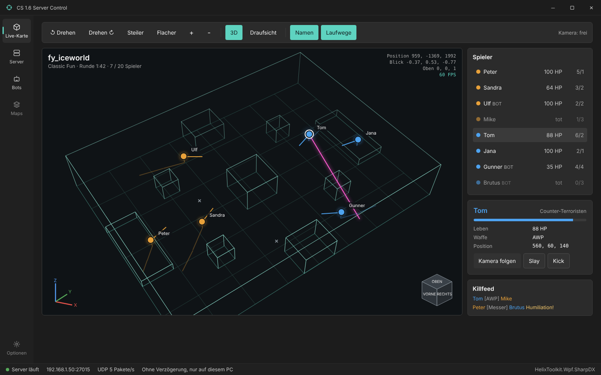
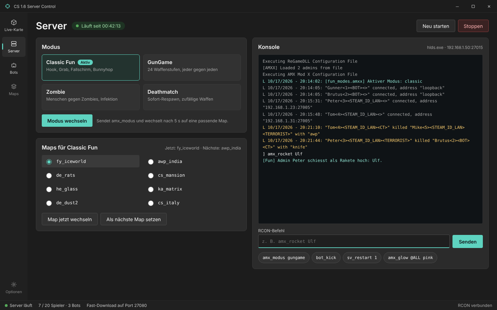
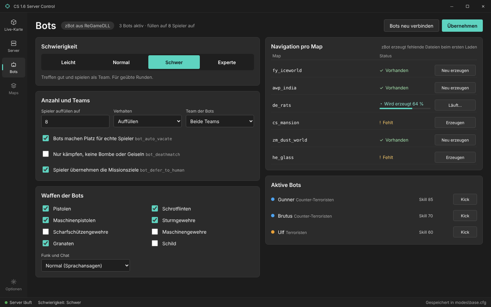

<div align="center">


# CS 1.6 LAN Fun Server

**A one-click Counter-Strike 1.6 fun server for the LAN party, like back in the day.**

[](CHANGELOG.md)


[](LICENSE)


[Quick start](#quick-start) ·
[Game modes](#game-modes) ·
[Server Control](#server-control) ·
[How it works](#how-it-works) ·
[Development](#development)

</div>

---

It happened at a LAN party: after twenty years, the whole group went straight back to
Counter-Strike 1.6. Same maps, same bunnyhops, same arguments about who camped. What was missing
was the server everyone remembered: the glowing grappling hook, GunGame, zombies, fy_iceworld and
a "Monster Kill!" booming through the room.

**CS 1.6 LAN Fun Server** brings that back in one Windows program. It installs the dedicated
server, the mods, the bots and a fun map pack, then starts and controls the server with a live 3D
map of the game. No scripts, no config archaeology: unpack, press Install, press Start, and the
server shows up under "LAN" in everyone's game.

<a href="docs/mockups/1-wpf-live-karte.png">
  
</a>

## Contents

- [Features](#features)
- [Status](#status)
- [Known issues](#known-issues)
- [Quick start](#quick-start)
- [Requirements](#requirements)
- [Game modes](#game-modes)
- [Server Control](#server-control)
- [Screenshots](#screenshots)
- [Playing on the LAN](#playing-on-the-lan)
- [How it works](#how-it-works)
- [Development](#development)
- [Credits](#credits)
- [Legal](#legal)
- [License](#license)

## Features

- **Five game modes**, switched by a `/mode` vote, the Fun menu or the app: Classic Fun, GunGame,
  Zombie, Deathmatch and Deathrun. Every mode has its own map list, so the end-of-map vote only
  offers maps that fit.
- **The fun plugins**, written for this package: the glowing grappling hook, grab, parachute,
  admin toys (rocket, glow, godmode, noclip, speed), surprise fun rounds (knives, AWP, low
  gravity, Juggernaut, ...), kill streak rewards and random spawns all over the map.
- **Bots that fill the gaps**: ReGameDLL's zBot fills the server up and makes room as soon as a
  human joins. Missing navigation meshes are built in a hidden helper server, never in the game
  the players are on.
- **A Server Control app** (WPF, .NET 10) in one self-contained exe, with a live 3D map, mode and
  map switching, bot settings, a map browser with a GameBanana market, stats and the installer.
- **Fast download** built in, so a player who misses a map gets it in seconds, not minutes.
- **Quake announcements**: "Headshot!", "Double Kill", "Monster Kill", "Humiliation".
- **Host settings never touch the package**: what the host changes goes into `local*.cfg` files
  next to the defaults, and every screen has a way back to the defaults.

## Status

> [!NOTE]
> **Built for one LAN party and run on one host PC.** The installer, the server and the app ran on
> Windows 10 Pro 64-bit (build 19045), with the server and the app on the same machine and zBot
> bots on the server. The 178 automated tests cover the parsers, writers and the camera. Not tried
> yet: Windows 11, a server reached over the internet, and every mode played through with a full
> server. Reports from other setups are welcome.

## Known issues

- **Zombie mode on `cs_` maps** would end rounds oddly through the hostage timeout, so those maps
  stay out of the Zombie map list.
- **Surf maps need `fps_max 100`** on every player's side. With more FPS the old engine's physics
  break on ramps, and the server cannot set it for them.
- **Deathrun runs without bots**: zBot does not know the traps.
- **Showing the Live Map on a projector** works like a wallhack for everyone in the room. That is
  the host's call.

## Quick start

1. Unpack the release zip to a permanent folder, for example `C:\Games\CS16-FunServer` (not the
   Downloads folder).
2. Run `4_SERVER_CONTROL.exe` and press **Install or repair** on the Install screen. It asks for
   your player name and an admin password, then installs everything (about 600 MB, once).
3. Press **Start** on the Server screen. The bar at the top shows the address, for example
   `192.168.1.50:27015`.

On the first start the app offers to add the Windows Firewall rules. Shortcuts can call the exe
with `--install`, `--start` or `--update-maps`.

The full player and admin guide (key binds, admin commands, every mode in detail,
troubleshooting) is [README.txt](README.txt), which also ships in the release zip.

## Requirements

| What | For whom |
| --- | --- |
| Windows 10 or 11, 64-bit | the host PC |
| Internet once, about 600 MB | the first install |
| Counter-Strike 1.6 on Steam | every player |
| .NET 10 SDK | only to build the app from source |

The published exe is self-contained, the host PC needs no .NET runtime.

## Game modes

| Mode | How it plays |
| --- | --- |
| Classic Fun | Normal CS with hook, grab, parachute, auto bunnyhop and a surprise fun round every third round |
| GunGame | Free-for-all, every kill gives the next weapon, a knife kill steals a level |
| Zombie | Random players turn into fast green zombies, one hit infects, humans win by surviving |
| Deathmatch | Free-for-all, instant respawn, random weapon, buy anywhere |
| Deathrun | One trapper presses the trap buttons, everybody else runs the course with a knife |

Type `/mode` in chat for a vote. Admins switch at once with `/fun` or
`amx_funmode classic|gungame|zombie|deathmatch|deathrun`.

## Server Control

`4_SERVER_CONTROL.exe` is the only thing the host runs. Every setting and server action is a
draft until Apply, and Discard drops it.

| Screen | What it does |
| --- | --- |
| Live Map | 3D wireframe of the current map with every player in real time: team color, view direction, hook beam, shot traces, kill feed with the game's weapon icons, fun commands per player |
| Server | Start, Stop, Restart, mode and map, game rules per mode, round actions, RCON console, HLTV for a TV |
| Bots | zBot difficulty, fill count, teams, weapons, radio and chat, kicks, added bots, nav mesh builds |
| Maps | Every installed map with picture, modes and nav state, plus the GameBanana market |
| Stats | Leaderboard, maps played tonight, how far the current map is |
| Install | Install or repair, rebuild plugins, with the log |
| Options | Server address, ports, firewall rules, RCON password |

## Screenshots

These are the approved design mockups the app was built from.

<table>
  <tr>
    <td><a href="docs/mockups/1-wpf-live-karte.png"></a></td>
    <td><a href="docs/mockups/2-wpf-server.png"></a></td>
    <td><a href="docs/mockups/3-wpf-bots.png"></a></td>
  </tr>
  <tr>
    <td align="center">Live Map</td>
    <td align="center">Server</td>
    <td align="center">Bots</td>
  </tr>
</table>

## Playing on the LAN

Other players only need a normal Counter-Strike 1.6 on Steam. The server shows up under "LAN"; if
not, `connect <host IP>:27015` in the console works too. Missing maps and sounds come over the
fast download server.

| Port | Protocol | What |
| --- | --- | --- |
| 27015 | UDP, TCP | the game server |
| 27080 | TCP | fast download (maps, sounds, models) |
| 27020 | UDP | HLTV for a TV or projector, only when enabled |
| 27016 | UDP | hidden nav build server, `127.0.0.1` only |
| 27090 | UDP | live map feed from the plugin, `127.0.0.1` only |

## How it works

- **Install chain**: SteamCMD installs HLDS, then ReHLDS, ReGameDLL, Metamod-R and AMX Mod X go
  on top, all pinned to known versions. The overlay in `server-files\cstrike` is copied over, the
  fun plugins are compiled with the shipped `amxxpc.exe`, and the map pack from `tools\maps.csv`
  is downloaded and sorted into the mode map lists by prefix.
- **Modes**: `modes\base.cfg` resets every cvar to vanilla, then `modes\<mode>.cfg` and
  `modes\maps\<prefix>.cfg` apply on top. Every cvar a mode changes is reset in `base.cfg`, so
  nothing leaks into the next map. Plugins read the active mode through `is_fun_mode()`, and only
  `fun_modes.amxx` writes it.
- **Polling without leaking**: the app reads status with the A2S server query, not RCON, because
  the engine writes every RCON command with its password into the logs.
- **The live map**: `fun_livemap` sends positions, shots and kills over UDP to `127.0.0.1:27090`.
  The app parses the map's BSP for the wireframe and draws it with HelixToolkit.
- **Bots**: zBot only learns a map starting from a bot, so nav files are built by a hidden helper
  HLDS on `127.0.0.1:27016` on an invisible desktop, without Metamod plugins and without touching
  the running game.

The app's spec is [docs/WPF-APP-HANDOVER.md](docs/WPF-APP-HANDOVER.md).

## Development

Build the app (runs the tests first, then copies `4_SERVER_CONTROL.exe` to the root):

```sh
dotnet publish app/CsServerControl -c Release                         # the exe
dotnet publish app/CsServerControl -c Release -p:PackRelease=true     # plus release/CS16-FunServer.zip
dotnet test app/CsServerControl.Tests                                 # tests only
```

Compile one plugin by hand after an install, in `server\cstrike\addons\amxmodx\scripting`:

```sh
amxxpc.exe fun_hook.sma -o..\plugins\fun_hook.amxx
```

Edit sources in `server-files\` and `app\`, never in `server\`, which the installer overwrites.
Branches follow git flow: work on `develop` or a `feature/*` branch off it, releases are merged
into `main` and tagged `vMAJOR.MINOR.PATCH` after [Semantic Versioning](https://semver.org/). See
[CHANGELOG.md](CHANGELOG.md) for what each release brought.

## Credits

Counter-Strike started as a Half-Life mod by Minh "Gooseman" Le and Jess Cliffe and became the
LAN game of a generation; without it there would be nothing to bring back.

This package stands on the work of the [ReHLDS](https://github.com/rehlds/ReHLDS),
[ReGameDLL_CS](https://github.com/rehlds/ReGameDLL_CS) and
[Metamod-R](https://github.com/rehlds/Metamod-R) teams, [AMX Mod X](https://www.amxmodx.org/),
[HelixToolkit](https://github.com/helix-toolkit/helix-toolkit),
[CommunityToolkit.Mvvm](https://github.com/CommunityToolkit/dotnet) and
[SharpCompress](https://github.com/adamhathcock/sharpcompress). The maps and sounds come from
their authors on [GameBanana](https://gamebanana.com/), credited in [README.txt](README.txt).

And thanks to the LAN crew who, twenty years later, still knew every corner of de_dust2.

## Legal

Counter-Strike and Half-Life are trademarks of Valve Corporation. This project is not affiliated
with or endorsed by Valve. It ships no game files: the server is downloaded from Valve through
SteamCMD, and every player needs their own copy of Counter-Strike 1.6. Maps and sounds are
downloaded from GameBanana under their authors' terms.

## License

CS 1.6 LAN Fun Server is released under the [MIT License](LICENSE). Copyright (c) 2026
DaRealHansForSure.

You may use, change and share it, also in your own projects, as long as you keep the copyright
notice and name the author. A link back to this repository is appreciated.
